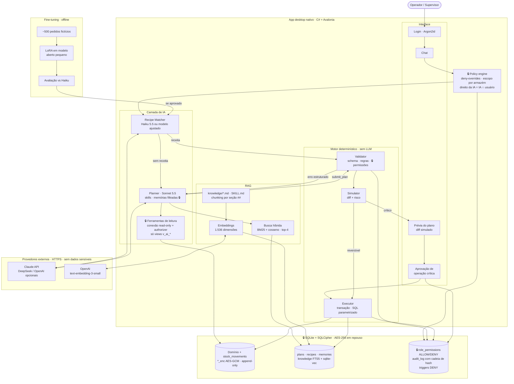
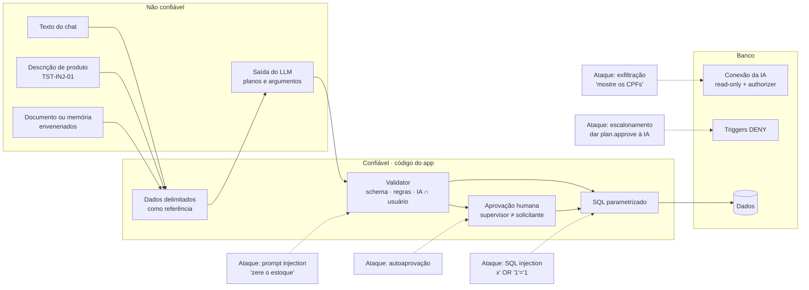
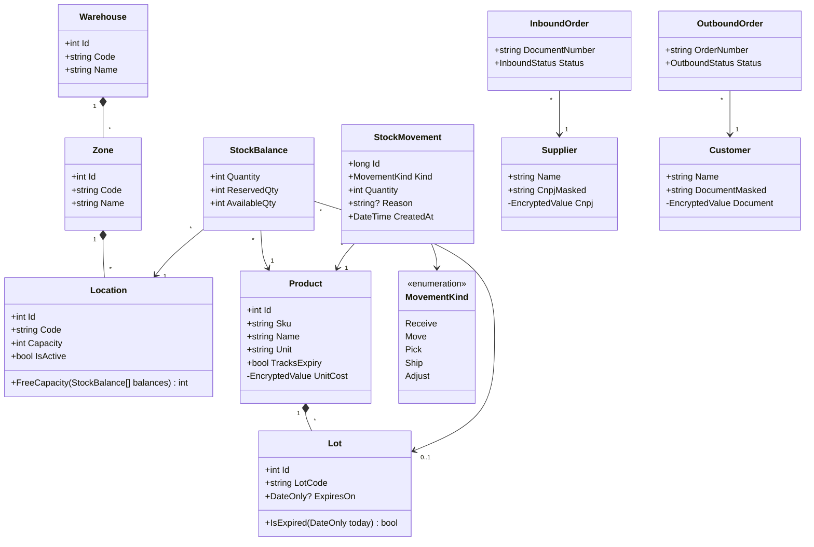
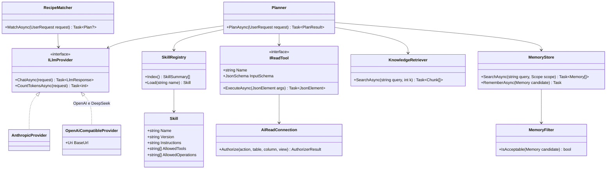
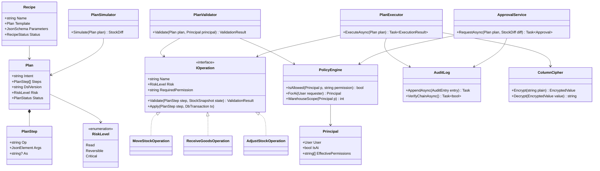
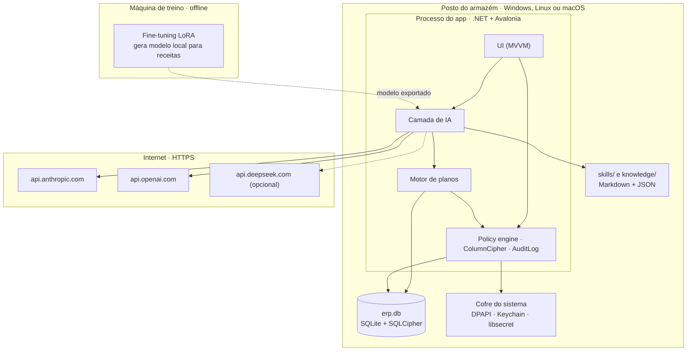

# Nexus: armazém gerenciado por IA

**Grupo:** ERP INTELIGENTE · **Repositório:** https://github.com/NatanCorreiaS/erp-inteligente

| Componente | Matrícula |
|------------|-----------|
| Natan Correia da Silva | 231071692 |
| Clara Gabryellen Paixão Aderno | 231070720 |
| Samuel Santos César | 232070317 |
| Rayan Santos Silva | 231070220 |

Entrega para as duas disciplinas: **Projeto de Inteligência Artificial** e **Segurança e Otimização de BD** (parte comum, parte de IA, parte de Segurança e parte de integração).

## Problema

Armazéns pequenos e médios controlam estoque com planilhas ou sistemas cheios de telas, que exigem treinamento e geram erros de digitação, estoque divergente e produtos vencidos. O **Nexus** é um app desktop em que o operador pede em português ("guarde as 40 caixas do ABC-123 que estão na doca") e uma IA consulta os dados, monta um plano, mostra o efeito e o executa **com segurança**. O supervisor só decide o que é crítico.

**Ideia central:** o LLM **descreve** as alterações em um plano JSON; um motor de código **valida, simula e executa** o plano numa transação. A IA nunca escreve no banco diretamente.

## Canvas

| Item | Resumo |
|------|--------|
| Usuário | Operadores e supervisores de armazém, sem equipe de TI |
| Entrada → saída | Pedido em linguagem natural → plano validado, estoque atualizado, resposta simples, auditoria |
| Arquitetura | App Avalonia → camada de IA (Planner, skills, RAG, memórias) → motor determinístico → SQLite + SQLCipher |
| Maior risco | A IA alterar o estoque de forma errada ou não autorizada (alucinação ou prompt injection) |
| MVP em 3 semanas | Recebimento e armazenagem via chat, motor de planos, RAG sobre os procedimentos, aprovação de críticos e auditoria |

Canvas completo, com a arquitetura em caixas: [`references/CANVAS.md`](references/CANVAS.md).

## Diagrama da arquitetura

Arquitetura integrada: LLM, RAG, fine-tuning, interface e banco, com permissões, proteção de dados e auditoria marcadas com 🔒. Outros diagramas (fluxo de uma tarefa, ciclos de vida, dados) em [`references/DIAGRAMAS.md`](references/DIAGRAMAS.md).



### Fronteiras de confiança e ataques testados

Cada seta tracejada é um ataque; o nó em que ela termina é a camada que o bloqueia.



## UML

### Casos de uso


### Classes do domínio (armazém)



### Classes da camada de IA



### Classes do motor de planos e segurança



### Componentes e implantação



## Tecnologia

App **desktop nativo** em **C# + Avalonia** (não é web nem SaaS). Banco **SQLite** criptografado com **SQLCipher**, com FTS5 e `sqlite-vec`. LLMs: **Claude Sonnet 5.5** (planejamento) e **Claude Haiku 5.5** (receitas), com DeepSeek e OpenAI configuráveis. Embeddings: `text-embedding-3-small`. SQL Server, MongoDB e n8n **não** são usados; a seção de Segurança mostra como cada mecanismo pedido foi implementado no SQLite. Detalhes em [`references/STACK.md`](references/STACK.md).

## Parte de IA

- **Diagrama da arquitetura** (LLM, RAG, fine-tuning e interface): seção [Diagrama da arquitetura](#diagrama-da-arquitetura) acima.
- **LLM e custo:** Sonnet 5.5 + Haiku 5.5 custam **≈ US$ 30,90 por 1.000 usos**, caindo para ≈ US$ 17,75 quando 60% dos pedidos viram receitas. Comparativo com Opus 5.5, Haiku puro e DeepSeek em [`references/IA.md`](references/IA.md).
- **RAG:** chunks por seção `##`, embeddings de 1.536 dimensões, `sqlite-vec` como banco vetorial, busca híbrida BM25 + cosseno com top-4.
- **Fine-tuning:** um modelo aberto pequeno com LoRA transforma pedidos em `{intent, recipe, params}`. Métricas: *exact match*, F1 por campo e % de JSON válido, comparados com o Haiku em *few-shot*.
- **Dados:** 22 documentos **fictícios** em [`knowledge/`](knowledge/README.md) (procedimentos e políticas de um centro de distribuição inventado).
- **Pontos difíceis:** alucinação, pedidos fora do escopo e prompt injection, com métricas e conjuntos de avaliação em [`references/IA.md`](references/IA.md), seção 5.

## Parte de Segurança

- **Modelo de dados** com cada coluna classificada como pública, interna ou sensível e a proteção dos sensíveis (AES-GCM, mascaramento, SQLCipher): [`references/SEGURANCA_DADOS.md`](references/SEGURANCA_DADOS.md), seção 2.
- **Matriz de papéis:** operador, supervisor, administrador, auditor e agente IA, com os pontos de `DENY` (seção 3).
- **Ameaças e gargalo**, e como provamos a defesa (seção 4).
- **Otimização medida** com 1 milhão de movimentos (seção 5):

| Consulta | Antes | Depois |
|----------|------:|-------:|
| Q1 kardex | 72,4 ms | 0,39 ms |
| Q2 FEFO | 33,8 ms | 9,4 ms |

- **Base inicial:** scripts em [`db/`](db/): `schema.sql`, `security.sql` (triggers e views), `seed.sql` (dados fictícios), `volume.sql`, `benchmark.sql` e `optimize.sql`.
- **Implementado no app (feature 1 do roadmap):**
  - **Banco e chaves:** SQLCipher no arquivo inteiro, com duas chaves aleatórias de 32 bytes guardadas no cofre do sistema (libsecret no Linux, DPAPI no Windows). Uma cópia do `.db` não abre ("file is not a database"), e o app nunca gera uma chave nova para um banco existente.
  - **Login e sessão:**
    - senhas em Argon2id (64 MiB, t=3, p=4);
    - bloqueio de 15 min após 5 falhas;
    - mensagem única, sem revelar se o usuário existe;
    - sessão que expira após 15 min sem uso.
  - **Três conexões:**
    - a da IA é somente leitura, com *authorizer* que só deixa ler as views `v_ai_*`;
    - a do Executor e a da Aplicação são de escrita, com `foreign_keys` ligado.
  - **Policy engine:** confere a permissão no banco a cada consulta (*deny-overrides*) e preenche o `$warehouse_id` da sessão; a IA age com a interseção dos direitos dela com os do usuário.
  - **Auditoria encadeada:** regra v1 de SHA-256, igual em Python e C#, verificada ao abrir o app e a cada login; uma cadeia quebrada aparece como alerta para quem tem `audit.read`.
  - Regras e números completos em [`references/ARQUITETURA.md`](references/ARQUITETURA.md), seção 12.

## Parte de integração

- **Diagrama único** juntando banco, LLM e RAG, com permissões, proteção de dados e auditoria marcadas: seção [Diagrama da arquitetura](#diagrama-da-arquitetura) acima, incluindo os ataques.
- **Matriz ampliada com a IA:** a IA lê só as views `v_ai_*` por uma conexão somente leitura e age com a **interseção** dos seus direitos com os de quem pediu. Ela nunca aprova nada nem vê dados sensíveis.
- **Ataques testados:** prompt injection (5 vetores, meta de 0% de sucesso) e SQL injection + escalonamento de privilégio, automatizados em `db/tests/test_db.py` (27 testes) e nos testes do app em `tests/Nexus.Tests` (267 testes, incluindo o *authorizer* da IA, o bloqueio de login, o isolamento entre armazéns e a detecção de adulteração da auditoria): [`references/SEGURANCA_DADOS.md`](references/SEGURANCA_DADOS.md), seção 6.

## Como rodar

```bash
# Criar e carregar o banco
sqlite3 erp.db < db/schema.sql
sqlite3 erp.db < db/security.sql
sqlite3 erp.db < db/seed.sql

# Volume e otimização
sqlite3 erp.db < db/volume.sql
sqlite3 erp.db < db/benchmark.sql   # antes
sqlite3 erp.db < db/optimize.sql
sqlite3 erp.db < db/benchmark.sql   # depois

# Testes de segurança e otimização
python3 -m unittest discover -s db/tests -v

# Gerar o PDF deste README, com os diagramas (precisa de Chrome/Chromium; o PDF não vai para o git)
python3 tools/readme_to_pdf.py               # gera README.pdf

# App desktop (.NET 10)
dotnet run                                   # banco em ~/.local/share/Nexus/nexus.db (Linux)
dotnet run -- --db /caminho/nexus.db         # outro arquivo
dotnet test tests/Nexus.Tests                # testes do app
```

No primeiro uso o app cria o banco criptografado a partir dos scripts de `db/` e guarda as chaves no cofre do sistema. Para entrar, use um dos usuários fictícios (`op.joao`, `sup.maria`, `adm.carlos`, `aud.lucia`) com a **senha de demonstração `nexus-demo-2026`**. Essa senha existe só para os dados fictícios do repositório e nunca deve ser usada com dados reais.

O Nexus ainda só consulta: alterar dados chega com o motor de planos (feature 2 do roadmap). Arquivos `.db` são ignorados pelo git.

## Documentação

| Documento | Conteúdo |
|-----------|----------|
| [`ARQUITETURA.md`](references/ARQUITETURA.md) | Arquitetura completa, incluindo segurança de dados (seção 12) |
| [`DIAGRAMAS.md`](references/DIAGRAMAS.md) | Arquitetura integrada, ataques, fluxo, ciclos de vida, dados |
| [`UML.md`](references/UML.md) | Casos de uso, classes, componentes e implantação |
| [`CANVAS.md`](references/CANVAS.md) | Canvas de uma página |
| [`IA.md`](references/IA.md) | LLM, custos, RAG, fine-tuning, riscos e métricas |
| [`SEGURANCA_DADOS.md`](references/SEGURANCA_DADOS.md) | Classificação, papéis, ameaças, otimização, ataques |

## Apresentação parcial (5 minutos)

1. **Problema e usuário** (1 min): canvas.
2. **Arquitetura** (2 min): diagrama integrado; o LLM planeja e o código executa.
3. **Segurança e IA** (1 min): matriz de papéis com a IA e ataques testados.
4. **Próximos passos** (1 min): MVP em 3 semanas.

## Regras atendidas

Não é web nem SaaS (app desktop nativo). Todos os dados são fictícios. Não há chaves de API nem senhas no repositório: as chaves ficam no cofre do sistema operacional.
