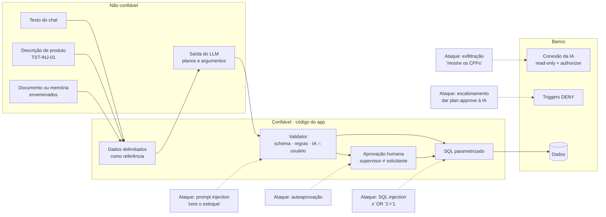
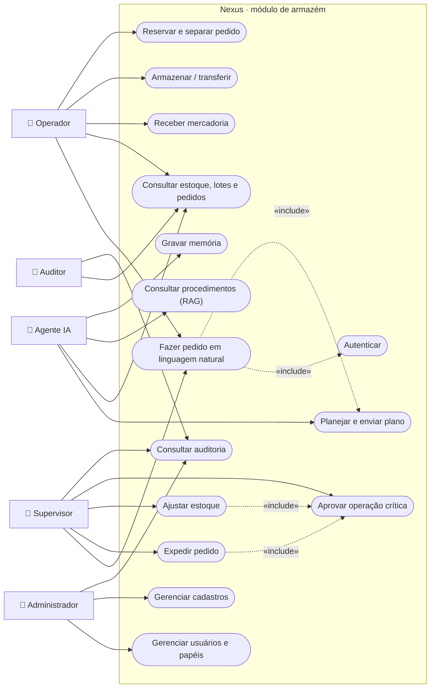
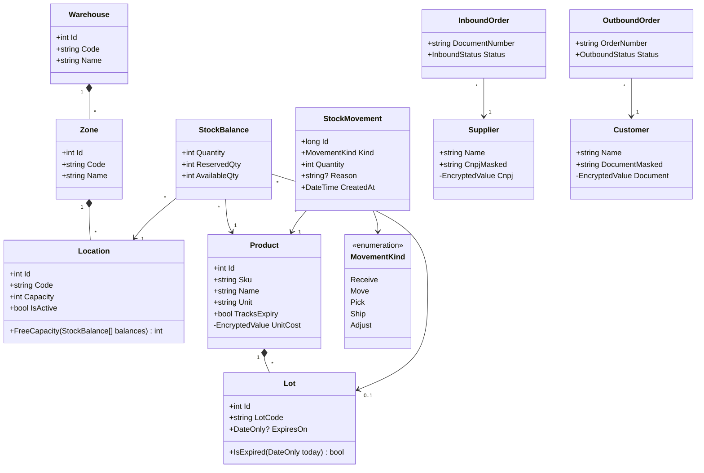
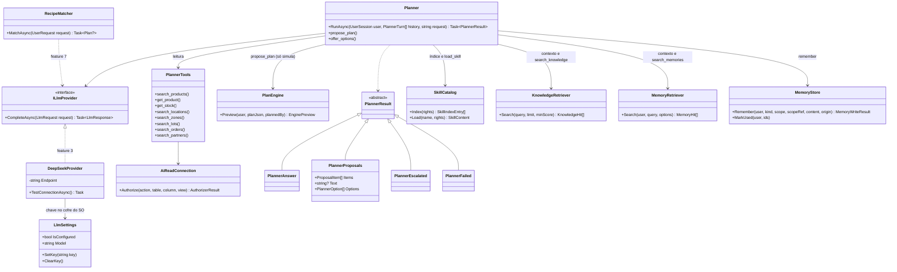
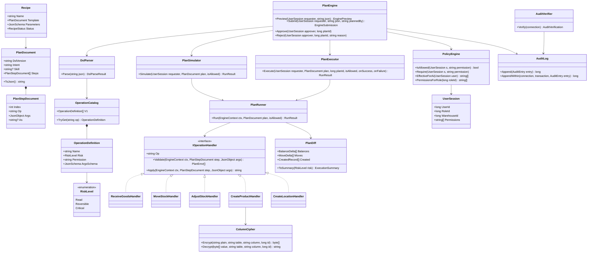
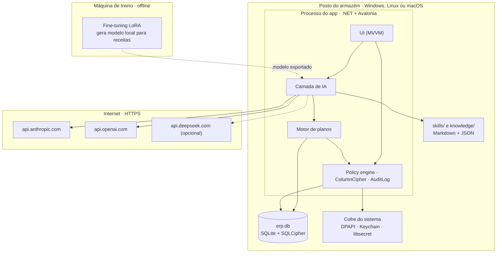

# Nexus: armazém gerenciado por IA

**Grupo:** ERP INTELIGENTE · **Repositório:** https://github.com/NatanCorreiaS/erp-inteligente

| Componente | Matrícula |
|------------|-----------|
| Natan Correia da Silva | 231071692 |
| Clara Gabryellen Paixão Aderno | 231070720 |
| Samuel Santos César | 232070317 |
| Rayan Santos Silva | 231070220 |

Entrega para as duas disciplinas: **Projeto de Inteligência Artificial** e **Segurança e Otimização de BD** (parte comum, parte de IA, parte de Segurança e parte de integração).

## Problema

Armazéns pequenos e médios controlam estoque com planilhas ou sistemas cheios de telas, que exigem treinamento e geram erros de digitação, estoque divergente e produtos vencidos. O **Nexus** é um app desktop em que o operador pede em português ("guarde as 40 caixas do ABC-123 que estão na doca") e uma IA consulta os dados, monta um plano, mostra o efeito e o executa **com segurança**. O supervisor só decide o que é crítico.

**Ideia central:** o LLM **descreve** as alterações em um plano JSON; um motor de código **valida, simula e executa** o plano numa transação. A IA nunca escreve no banco diretamente.

## Canvas

| Item | Resumo |
|------|--------|
| Usuário | Operadores e supervisores de armazém, sem equipe de TI |
| Entrada → saída | Pedido em linguagem natural → plano validado, estoque atualizado, resposta simples, auditoria |
| Arquitetura | App Avalonia → camada de IA (Planner, skills, RAG, memórias) → motor determinístico → SQLite + SQLCipher |
| Maior risco | A IA alterar o estoque de forma errada ou não autorizada (alucinação ou prompt injection) |
| MVP em 3 semanas | Recebimento e armazenagem via chat, motor de planos, RAG sobre os procedimentos, aprovação de críticos e auditoria |

Canvas completo, com a arquitetura em caixas: [`references/CANVAS.md`](references/CANVAS.md).

## Diagrama da arquitetura

Arquitetura integrada: LLM, RAG, fine-tuning, interface e banco, com permissões, proteção de dados e auditoria marcadas com 🔒. Outros diagramas (fluxo de uma tarefa, ciclos de vida, dados) em [`references/DIAGRAMAS.md`](references/DIAGRAMAS.md).


### Fronteiras de confiança e ataques testados

Cada seta tracejada é um ataque; o nó em que ela termina é a camada que o bloqueia.



## UML

### Casos de uso



### Classes do domínio (armazém)



### Classes da camada de IA



### Classes do motor de planos e segurança



### Componentes e implantação



## Tecnologia

App **desktop nativo** em **C# + Avalonia** (não é web nem SaaS). Banco **SQLite** criptografado com **SQLCipher**, com FTS5 e `sqlite-vec`. LLMs: **Claude Sonnet 5.5** (planejamento) e **Claude Haiku 5.5** (receitas), com DeepSeek e OpenAI configuráveis. Embeddings: `text-embedding-3-small`. SQL Server, MongoDB e n8n **não** são usados; a seção de Segurança mostra como cada mecanismo pedido foi implementado no SQLite. Detalhes em [`references/STACK.md`](references/STACK.md).

## Parte de IA

- **Diagrama da arquitetura** (LLM, RAG, fine-tuning e interface): seção [Diagrama da arquitetura](#diagrama-da-arquitetura) acima.
- **LLM e custo:** Sonnet 5.5 + Haiku 5.5 custam **≈ US$ 30,90 por 1.000 usos**, caindo para ≈ US$ 17,75 quando 60% dos pedidos viram receitas. Comparativo com Opus 5.5, Haiku puro e DeepSeek em [`references/IA.md`](references/IA.md).
- **RAG:** chunks por seção `##` dos 22 procedimentos, indexados na abertura, com busca FTS5/BM25 sem acento; memórias e trechos relevantes entram no pedido como dados delimitados. Com embeddings ligados em Configurações (OpenAI `text-embedding-3-small` ou um modelo local em `127.0.0.1`), a busca é híbrida: top-20 do BM25 + top-20 por cosseno (distância pelo `sqlite-vec`), combinados por *Reciprocal Rank Fusion*; a pergunta vai mascarada e, sem embeddings, a busca continua só BM25.
- **Memórias:** por armazém, gravadas pela IA (`remember`) e pelo sistema (rejeições) através de um filtro que recusa dados pessoais e texto com cara de instrução; só o supervisor corrige e arquiva, na tela Memórias.
- **Fine-tuning:** um modelo aberto pequeno com LoRA transforma pedidos em `{intent, recipe, params}`. Métricas: *exact match*, F1 por campo e % de JSON válido, comparados com o Haiku em *few-shot*.
- **Dados:** 22 documentos **fictícios** em [`knowledge/`](knowledge/README.md) (procedimentos e políticas de um centro de distribuição inventado).
- **Ferramentas da IA:** oito de leitura (`search_products`, `get_product`, `get_stock`, `search_locations`, `search_zones`, `search_lots`, `search_orders`, `search_partners`), `load_skill` (corpo de uma skill sob demanda), `propose_plan` (até 3 alternativas, só simula), `propose_skill` (rascunho de skill, só para o supervisor), `search_knowledge` e `search_memories` (BM25), `remember` (memória pelo filtro de proteção) e `offer_options` (botões). A IA só vê o que o direito efetivo permite.
- **Skills (feature 4):** procedimentos no formato `SKILL.md` dos agentes de IA (`nome`, `descricao`, `operacoes` e corpo em Markdown), em português. O prompt leva só o índice e a IA carrega o corpo quando precisa. As 6 iniciais vêm embutidas; as criadas ficam no banco cifrado, com versões e auditoria. Só o supervisor (`skill.manage`) cria e edita, na tela Skills ou confirmando uma skill redigida pela IA; os demais papéis só leem.
- **Modo proativo:** assume padrões razoáveis e lista as suposições. Se a zona, o endereço ou o produto não existe, propõe o plano que o cria antes da movimentação.
- **Pontos difíceis:** alucinação, pedidos fora do escopo e prompt injection, com métricas e conjuntos de avaliação em [`references/IA.md`](references/IA.md), seção 5. Os conjuntos (50 pedidos com gabarito, 40 perguntas sobre os procedimentos, 30 fora do escopo e 10 proativos) ficam em `tools/eval` e rodam com `tools/Nexus.Eval`. Medido sem LLM: o RAG acha o documento certo entre os 4 primeiros em 100% das perguntas; em 1º lugar, 80% só com BM25 e 87,5% na busca híbrida com o modelo local.

## Parte de Segurança

- **Modelo de dados** com cada coluna classificada como pública, interna ou sensível e a proteção dos sensíveis (AES-GCM, mascaramento, SQLCipher): [`references/SEGURANCA_DADOS.md`](references/SEGURANCA_DADOS.md), seção 2.
- **Matriz de papéis:** operador, supervisor, administrador, auditor e agente IA, com os pontos de `DENY` (seção 3).
- **Catálogo de operações:** 20 operações da DSL v1, cada uma com permissão e risco. Quatro são críticas e exigem outro supervisor:

| Risco | Operações |
|-------|-----------|
| Crítico | `adjust_stock`, `cancel_inbound_order`, `ship_order`, `cancel_outbound_order` |
| Reversível | `receive_goods`, `move_stock`, `create_product`, `update_product`, `create_supplier`, `create_customer`, `create_zone`, `update_zone`, `create_location`, `create_location_range`, `update_location`, `create_inbound_order`, `create_outbound_order`, `reserve_stock`, `release_reservation`, `pick_items` |

Permissão e regras de cada uma em [`references/ARQUITETURA.md`](references/ARQUITETURA.md), seção 5.
- **Ameaças e gargalo**, e como provamos a defesa (seção 4).
- **Otimização medida** com 1 milhão de movimentos (seção 5):

| Consulta | Antes | Depois |
|----------|------:|-------:|
| Q1 kardex | 72,4 ms | 0,39 ms |
| Q2 FEFO | 33,8 ms | 9,4 ms |

- **Base inicial:** scripts em [`db/`](db/): `schema.sql`, `security.sql` (triggers e views), `seed.sql` (dados fictícios), `volume.sql`, `benchmark.sql` e `optimize.sql`.
- **Implementado no app (feature 1 do roadmap):**
  - **Banco e chaves:** SQLCipher no arquivo inteiro, com duas chaves aleatórias de 32 bytes guardadas no cofre do sistema (libsecret no Linux, DPAPI no Windows). Uma cópia do `.db` não abre ("file is not a database"), e o app nunca gera uma chave nova para um banco existente.
  - **Login e sessão:**
    - senhas em Argon2id (64 MiB, t=3, p=4);
    - bloqueio de 15 min após 5 falhas;
    - mensagem única, sem revelar se o usuário existe;
    - sessão que expira após 15 min sem uso.
  - **Três conexões:**
    - a da IA é somente leitura, com *authorizer* que só deixa ler as views `v_ai_*`;
    - a do Executor e a da Aplicação são de escrita, com `foreign_keys` ligado.
  - **Policy engine:** confere a permissão no banco a cada consulta (*deny-overrides*) e preenche o `$warehouse_id` da sessão; a IA age com a interseção dos direitos dela com os do usuário.
  - **Auditoria encadeada:** regra v1 de SHA-256, igual em Python e C#, verificada ao abrir o app e a cada login; uma cadeia quebrada aparece como alerta para quem tem `audit.read`.
  - Regras e números completos em [`references/ARQUITETURA.md`](references/ARQUITETURA.md), seção 12.
- **Implementado no app (feature 2 do roadmap): motor determinístico de planos.**
  - **DSL e validação:** DSL JSON v1 validada por JSON Schema, com limites contra entrada maliciosa, e por regras de negócio (saldo disponível, capacidade, lote e validade, escopo do armazém).
  - **Simulação:** roda o mesmo código da execução, dentro de uma transação desfeita, então a pré-visualização mostra exatamente o que vai acontecer.
  - **Execução:** transacional, tudo ou nada, com a auditoria gravada na mesma transação.
  - **Aprovação:**
    - planos críticos (`adjust_stock`, `cancel_inbound_order`, `ship_order`, `cancel_outbound_order`) esperam um supervisor diferente de quem pediu;
    - a IA nunca aprova;
    - o que pode rodar é decidido pelos direitos de quem pediu, não de quem aprova.
  - **Tela "Novo plano":** formulários gerados do catálogo, com listas de escolha e o próximo código livre. Monta o plano sem LLM, mostra a pré-visualização e envia.
  - **Atualização de bancos antigos:** um banco existente é atualizado na abertura por migrações versionadas (`db/migrations/`), até a versão 8 (consumo de tokens).

## Parte de integração

- **Diagrama único** juntando banco, LLM e RAG, com permissões, proteção de dados e auditoria marcadas: seção [Diagrama da arquitetura](#diagrama-da-arquitetura) acima, incluindo os ataques.
- **Matriz ampliada com a IA:** a IA lê só as views `v_ai_*` por uma conexão somente leitura e age com a **interseção** dos seus direitos com os de quem pediu. Ela nunca aprova nada, não vê dados sensíveis e não grava skills (as próprias instruções). Desde 2026-11-08 ela tem os direitos operacionais do usuário (ajuste, expedição, cadastros e pedidos), com confirmação de quem pediu e aprovação de outro supervisor para críticos.
- **Ataques testados:** prompt injection (5 vetores) e SQL injection + escalonamento de privilégio, automatizados em `db/tests/test_db.py` (115 testes) e nos testes do app em `tests/Nexus.Tests` (1425 testes, incluindo o *authorizer* da IA, o bloqueio de login, o isolamento entre armazéns, a detecção de adulteração da auditoria, planos maliciosos e a segregação de funções na aprovação): [`references/SEGURANCA_DADOS.md`](references/SEGURANCA_DADOS.md), seção 6.
- **Suíte de 25 ataques com métricas (feature 6):** o modelo é simulado obedecendo à injeção, e as defesas fora dele seguram tudo. Resultado: **0% de sucesso dos ataques e 100% de detecção**. Textos suspeitos nos dados são marcados, auditados como `ai.injection` e avisados ao operador. A auditoria mascara CPF, CNPJ, e-mail, telefone e chaves antes do hash.
- **Operação (feature 9):**
  - **Backup:** backup criptografado diário pela API do SQLite (mesma chave do SQLCipher, 7 cópias). O administrador também faz e restaura backups, e a restauração é verificada antes.
  - **Memórias:** um job diário arquiva memórias repetidas, parecidas ou sem uso.
  - **Auditoria:** painel com filtros e verificação da cadeia.
  - **Custos:** painel com tokens e custo estimado por papel e modelo, a partir de `llm_usage`.
  - **Instaladores:** Windows (zip e Inno Setup) e Linux (tar.gz com `install.sh`), *self-contained*.
- **Multi-provedor e fine-tuning (feature 8):** DeepSeek, Claude (pelo SDK oficial da Anthropic), OpenAI e um modelo local ajustado. O administrador escolhe, em Configurações, o provedor e o modelo do planejamento e do reconhecimento de receitas. As chaves ficam no cofre do sistema, uma por provedor. O experimento de fine-tuning do Matcher está em `tools/finetune`. O Qwen2.5-1.5B com LoRA foi treinado numa GTX 1660 (3 h) e teve 100% no teste gerado. Nos 40 pedidos escritos à mão, teve 80% de *exact match*, porque inventava o valor que faltava. O app passou a recusar todo valor que não está no pedido (`RecipeGrounding`, para qualquer provedor), e com isso o resultado subiu para 92,5%. A comparação com o Haiku depende da chave da Anthropic ([`IA.md`](references/IA.md), seção 4).
- **Receitas (feature 7):** 3 planos iguais executados viram uma receita candidata, que só o supervisor promove. Uma receita ativa é usada pela tela Receitas sem LLM, ou reconhecida pelo Recipe Matcher (uma chamada curta ao modelo rápido, sem ferramentas) antes do planejamento. O plano gerado passa pelo motor como qualquer outro. A receita é suspensa quando a DSL ou a skill muda, e despromovida após 3 falhas seguidas.

## Como rodar

```bash
# Criar e carregar o banco
sqlite3 erp.db < db/schema.sql
sqlite3 erp.db < db/security.sql
sqlite3 erp.db < db/seed.sql

# Volume e otimização
sqlite3 erp.db < db/volume.sql
sqlite3 erp.db < db/benchmark.sql   # antes
sqlite3 erp.db < db/optimize.sql
sqlite3 erp.db < db/benchmark.sql   # depois

# Testes de segurança e otimização
python3 -m unittest discover -s db/tests -v

# Gerar o PDF deste README, com os diagramas (precisa de Chrome/Chromium; o PDF não vai para o git)
python3 tools/readme_to_pdf.py               # gera README.pdf

# App desktop (.NET 10)
dotnet run                                   # banco em ~/.local/share/Nexus/nexus.db (Linux)
dotnet run -- --db /caminho/nexus.db         # outro arquivo
dotnet test tests/Nexus.Tests                # testes do app
```

No primeiro uso o app cria o banco criptografado a partir dos scripts de `db/` e guarda as chaves no cofre do sistema. Para entrar, use um dos usuários fictícios (`op.joao`, `sup.maria`, `adm.carlos`, `aud.lucia`) com a **senha de demonstração `demo`**. Essa senha existe só para os dados fictícios do repositório e nunca deve ser usada com dados reais.

Para o **Nexus** conversar, o administrador (`adm.carlos`) cola a chave de API da DeepSeek em **Configurações → Provedor de LLM**. A chave vai para o cofre do sistema, nunca para o banco nem para o repositório. Depois disso, peça em linguagem natural. Exemplos:
- "guarde as 40 caixas do ABC-123 da doca em A-02-01": o Nexus consulta o estoque pelas views `v_ai_*` e devolve uma **proposta** com o efeito simulado;
- "guarde 10 cx do ABC-123 em Q-01-01", com a zona Q ainda inexistente: o Nexus propõe, num só plano, a zona Q, os endereços e a movimentação, e lista as suposições (capacidade, por exemplo);
- "quais endereços da zona A têm espaço para 40 caixas?": o Nexus consulta e responde, e pode oferecer os próximos passos como botões.

Nada é gravado até quem pediu clicar em **Confirmar**. Quando há mais de uma forma de fazer, o Nexus mostra até três propostas para escolher. Cada proposta traz o porquê e as suposições assumidas; SKU, endereço, zona e pedido aparecem destacados na resposta.

Ajustes, expedições e cancelamentos também podem ser pedidos, desde que quem pede tenha o direito. Planos críticos ficam em **Planos** esperando a aprovação de outro supervisor. A tela **Novo plano** continua disponível para montar qualquer plano sem IA. Arquivos `.db` são ignorados pelo git.

## Documentação

| Documento | Conteúdo |
|-----------|----------|
| [`ARQUITETURA.md`](references/ARQUITETURA.md) | Arquitetura completa, incluindo segurança de dados (seção 12) |
| [`DIAGRAMAS.md`](references/DIAGRAMAS.md) | Arquitetura integrada, ataques, fluxo, ciclos de vida, dados |
| [`UML.md`](references/UML.md) | Casos de uso, classes, componentes e implantação |
| [`CANVAS.md`](references/CANVAS.md) | Canvas de uma página |
| [`IA.md`](references/IA.md) | LLM, custos, RAG, fine-tuning, riscos e métricas |
| [`SEGURANCA_DADOS.md`](references/SEGURANCA_DADOS.md) | Classificação, papéis, ameaças, otimização, ataques |

## Apresentação parcial (5 minutos)

1. **Problema e usuário** (1 min): canvas.
2. **Arquitetura** (2 min): diagrama integrado; o LLM planeja e o código executa.
3. **Segurança e IA** (1 min): matriz de papéis com a IA e ataques testados.
4. **Próximos passos** (1 min): MVP em 3 semanas.

## Regras atendidas

Não é web nem SaaS (app desktop nativo). Todos os dados são fictícios. Não há chaves de API nem senhas no repositório: as chaves ficam no cofre do sistema operacional.
