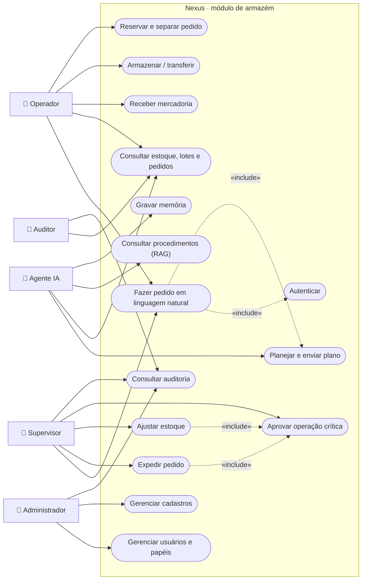
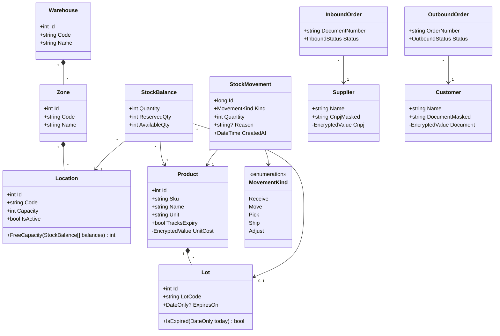
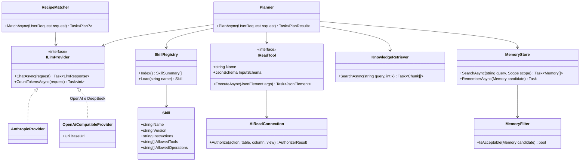
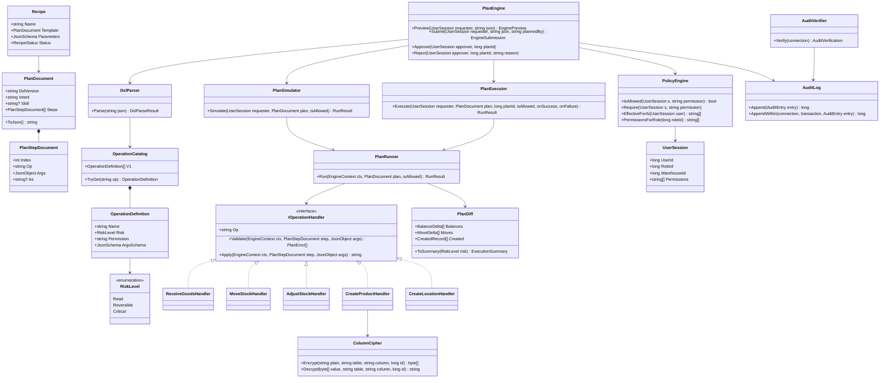
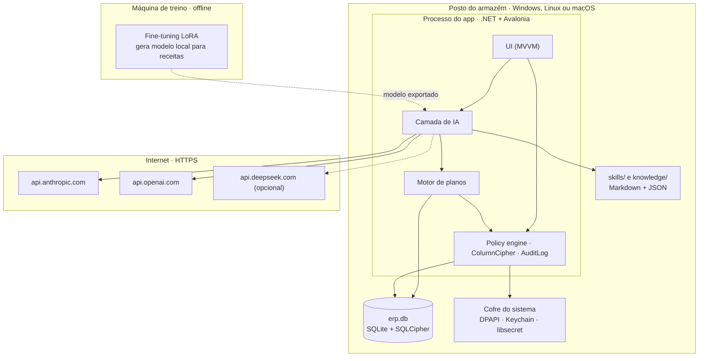

# UML

> Diagramas UML do projeto em Mermaid. Os nomes de classes estão em inglês, como o código C# (ver [`STACK.md`](STACK.md)). Base: [`ARQUITETURA.md`](ARQUITETURA.md).

## 1. Casos de uso

O Mermaid não tem diagrama de casos de uso; ele é representado com atores à esquerda e casos de uso em formato de cápsula. `«include»` marca casos sempre executados juntos.

## 2. Classes do domínio (armazém)

## 3. Classes da camada de IA

## 4. Classes do motor de planos e segurança

## 5. Componentes e implantação

